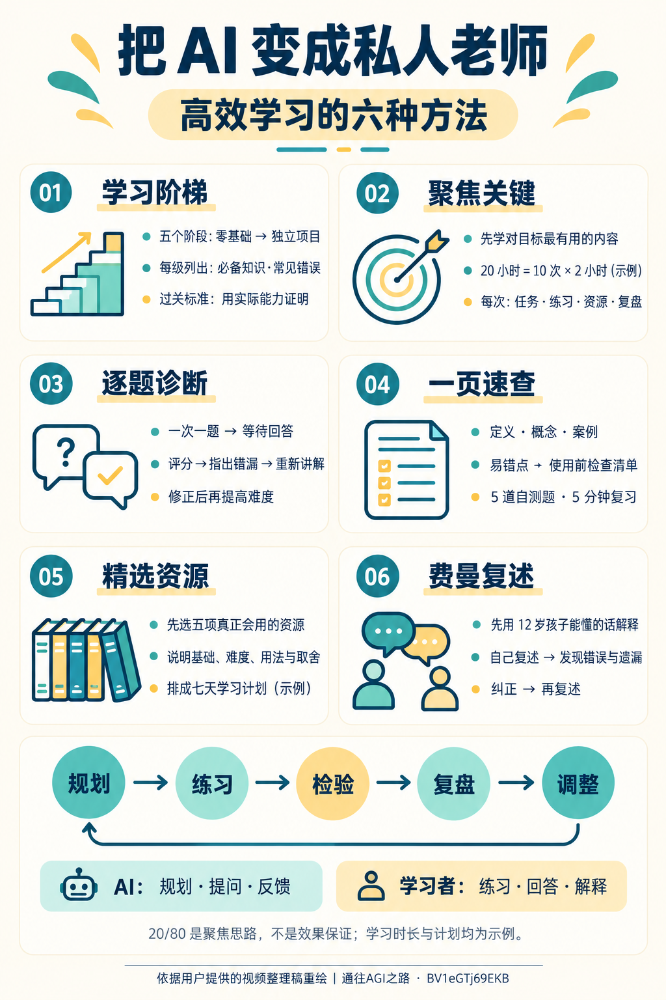

# 把 AI 变成私人老师的六种方法

[返回仓库首页](README.md) · [开始学习](START_HERE.md) · [Agent 系统学习路线](topics/agent-systems/ROADMAP.md)

来源：[原视频](https://www.bilibili.com/video/BV1eGTj69EKB/)，UP 主：通往AGI之路，视频时长约 3 分 55 秒。

本文依据用户提供的视频内容整理稿恢复，未独立观看或核验原视频。提示词按整理稿原意改写，方便直接使用，不是逐字转录。涉及时间和数量的安排是示例，不保证在固定时长内掌握一项技能。

核心思路是让 AI 参与规划、提问、整理与反馈；学习者通过练习、回答和解释，把信息转化成自己的能力。



## 1. 学习阶梯：先弄清楚自己该学什么

基础概念还没建立联系就挑战复杂项目，容易越学越混乱。先把目标拆成不同阶段，每阶段写清必备知识、容易犯的错误，以及进入下一阶段前应展示的能力。

**可复制提示词：**

```text
我想学习【主题】，起点是零基础，终点是能够独立完成一个项目。
请设计一条分为五个阶段的学习路线。每个阶段列出：
1. 阶段目标和必备知识；
2. 一个可以动手完成的产物；
3. 容易犯的错误；
4. 进入下一阶段前应达到的能力标准。
能力标准请写成能通过运行、演示或回答检查的行为，不只写“理解”或“熟悉”。
请解释必要术语，并让后续阶段建立在前面已经练过的能力上。
```

**留下的成果：** 一张阶段地图，标明当前所在位置和下一步任务。“看过了”不等于“已经过关”。

## 2. 聚焦关键：把大目标拆成具体安排

一项技能中，不同内容对当前目标的价值不同。借用“先抓住最有用的少量内容”的思路，把时间优先分配给基础和实际练习，而不是急着学习所有工具、插件或高级功能。

**可复制提示词：**

```text
我想学习【主题】，当前基础是【已有能力】，希望实现【具体目标】。
假设这轮准备投入 20 小时，请优先挑出最能帮助我实现目标的核心内容，
安排为十次学习，每次两小时。
每次写清学习任务、动手练习、所需资源、可检查的产物，
以及结束后要回答的复盘问题。
如果目标超出这轮时间能合理完成的范围，请缩小本轮目标并说明后续内容。
```

**留下的成果：** 一份能执行的学习安排。20 小时、十次、每次两小时是计划示例，可以根据实际进度调整；“20/80”用于提醒自己选择重点，不是精确的效果保证。

## 3. 逐题诊断：找出理解中的缺口

看讲解时觉得清楚，不代表自己能独立回答或应用。让 AI 一次只问一道题，根据你的回答逐步增加难度，并针对具体误解提供反馈。

**可复制提示词：**

```text
我刚学完【主题】，请通过提问检查我的理解。
每轮只出一道题，等我回答后再继续，不要提前给答案。
题目难度逐步增加。请给我的回答评分，说明正确之处、错误和遗漏，
并针对薄弱部分重新讲解，再让我尝试一次。
如果证据不足，请说明还需要哪种回答或实践结果，不要直接判定我已经掌握。
```

**留下的成果：** 错误清单、修正后的答案和需要补做的练习。评分是反馈工具，实际能否完成任务才是主要证据。

## 4. 一页速查：快速恢复知识结构

每学完一个主题，把知识整理成一页。保留一句话定义、关键概念、实际例子、常见错误、使用前检查清单，以及五道快速自测题，方便在再次使用前快速回顾。

**可复制提示词：**

```text
请把刚才学过的【主题】整理成一页速查表，方便我在五分钟内复习。
请包含：
1. 一句话定义；
2. 核心概念及其关系；
3. 一个实际例子；
4. 常见错误；
5. 使用前检查清单；
6. 五道快速自测题。
表达简短，结构清楚。自测题先不要附答案，等我回答后再检查。
```

**留下的成果：** 一页速查表。可以在做项目、准备考试或面试前使用，但仍要回到实际练习检验能力。

## 5. 精选资源：减少无效选择

资料越多，越容易把时间花在寻找和收藏上。按目标筛选少量资源，说明适用基础、难度、使用方式和可略过部分，再安排学习顺序。

**可复制提示词：**

```text
针对【主题】，我的基础是【当前水平】，目标是【想完成的任务】。
请挑选五项值得优先学习的资源，分别说明：
适合什么基础的人、难度、推荐使用方式，以及可以略过的部分。
请提供资源名称和来源；不能核实的链接或信息请明确标注。
再利用这些资源安排一份七天学习计划，每天包含一次实际练习。
七天是本轮安排示例，不需要承诺七天掌握全部内容。
```

**留下的成果：** 一份真正会使用的短资源清单和练习安排。遇到学习缺口再补资源，不必一次收藏所有资料。

## 6. 费曼复述：检查自己能否讲明白

先让 AI 用简单语言解释，再用自己的话复述。请 AI 检查错误、遗漏和概念混淆，然后重新讲一遍。避免用术语掩盖没有弄清楚的部分。

**可复制提示词：**

```text
请先用适合 12 岁孩子理解的语言讲解【概念】，给一个贴近生活的例子。
接着让我用自己的话复述，并等待我的回答。
请检查我的解释是否准确、完整，有没有混淆概念，
或用术语掩盖不理解的地方。
指出问题后，让我重新讲一遍，再检查我是否修正了这些问题。
```

**留下的成果：** 一段自己能说清楚的解释，以及可以用来说明概念的例子。

## 把六种方法连起来

```text
学习阶梯定位 → 聚焦关键并安排练习 → 精选当前需要的资源
                                     ↓
                              动手完成一个小任务
                                     ↓
                         逐题诊断 → 修正具体问题
                                     ↓
                         一页速查 → 费曼复述
                                     ↓
                     用实际证据决定是否进入下一阶段
```

先从当前阶段的一次小练习开始。AI 负责帮助规划、提问和反馈；是否过关，要看自己的实际运行结果、回答和解释。
