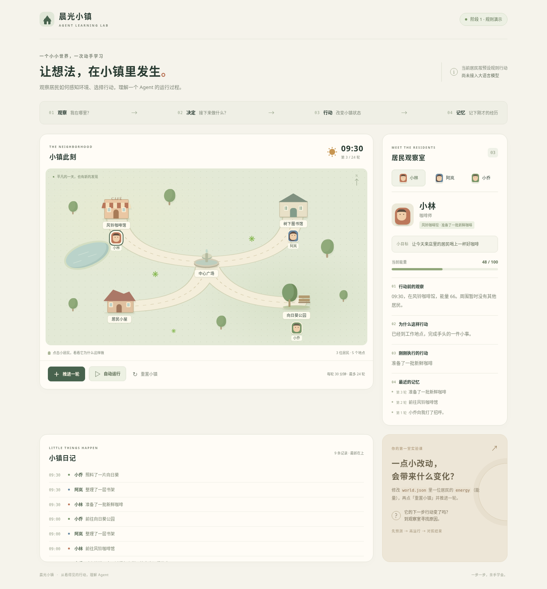

# 我的 AI 学习仓库

## 置顶：把 AI 变成私人老师的六种方法

| 方法 | 让 AI 帮你做什么 | 自己要留下什么 |
| --- | --- | --- |
| 1. 学习阶梯 | 拆成五个阶段，写清知识、常见错误和过关标准 | 当前阶段与下一步练习 |
| 2. 聚焦关键 | 优先挑出对目标最有用的内容，拆成可执行安排 | 每次学习的任务与实际产物 |
| 3. 逐题诊断 | 一次只问一道题，等回答后再反馈 | 错误、遗漏与修正后的答案 |
| 4. 一页速查 | 整理定义、概念、例子、易错点、检查清单和自测 | 能在五分钟内复习的速查表 |
| 5. 精选资源 | 筛选少量资料，说明适用对象与使用顺序 | 真正使用过的资料与练习记录 |
| 6. 费曼复述 | 用简单语言解释，再检查你的复述 | 不依赖术语也能讲清楚的解释 |

**[打开完整学习方法与六段可复制提示词 →](LEARNING_METHODS.md)**

[查看六种学习方法图解（依据整理稿重绘）](assets/ai-learning-methods.png)

使用顺序可以是：定位阶段 → 挑关键内容 → 动手练习 → 逐题检查 → 整理速查表 → 用自己的话复述。资源按当前缺口选择，不必先把所有资料收集齐。

## 从 AI 小镇开始第一个主题

**学习主题：构建可运行的 Agent 系统。** 从零基础开始，逐步做到独立运行、解释、检查并修改一个完整项目。

**练习项目：AI 小镇。** 目标是让真实模型根据角色、目标、观察和记忆自主决定行动与对白，逐步学会形成并调整多步计划。当前代码仍是规则驱动演示，尚未接入模型。

**下一项实践：让一个 NPC 真正用模型做决定。** 已有规则小镇作为运行环境和对照，接下来观察“模型收到什么 → 选择什么 → 程序实际执行了什么”。基础知识随实践补充；当前学习状态见[主题首页](topics/agent-systems/README.md)。

- **[从这里开始](START_HERE.md)**：第一次打开仓库时的操作入口。
- **[AI 小镇项目](projects/ai-town/README.md)**：项目说明、运行方式和当前能力。
- **[学习主题首页](topics/agent-systems/README.md)**：当前阶段与学习入口。
- **[完整五阶段学习路线](topics/agent-systems/ROADMAP.md)**：各阶段必备知识、常见错误和验收标准。



| 阶段 | 学习重点 | 应能展示的能力 |
| --- | --- | --- |
| 1. 编程与开发基础 | 终端、程序、文件、JSON、异常与 Git | 本地运行并修改一个小程序，检查输入和输出 |
| 2. NPC 接入模型 | 角色观察、结构化决策、真实调用与错误处理 | 一位 NPC 根据真实模型响应提出行动 |
| 3. 工具调用与循环 | 工具参数、程序执行、结果回传、停止条件 | 展示多步执行轨迹，并在达到限制时停止 |
| 4. 记忆、互动与评测 | 局部观察、独立记忆、交流、存读档和固定任务 | 检查角色知道什么、如何互动及失败处理 |
| 5. 可复现独立项目 | 模块、依赖、说明文档、验收与需求变更 | 按文档在新环境运行，并独立完成一个小需求 |

阶段以实际运行、回答和解释为依据；仓库里已有示例，不等于学习者已经完成对应阶段。

## 仓库怎么用

```text
README.md                   置顶方法和总入口
LEARNING_METHODS.md          六种方法与可复制提示词
START_HERE.md               第一次开始的操作说明
AGENTS.md                   AI 协作约定
topics/agent-systems/        首个主题、路线与学习记录
projects/ai-town/            AI 小镇项目
```

每次只选一个能实际完成的小任务，记录“做了什么、实际结果、哪里卡住、下一步”。学习时可以让 AI 逐题检查；需要实现功能时，直接说明希望完成的修改和预期行为。
